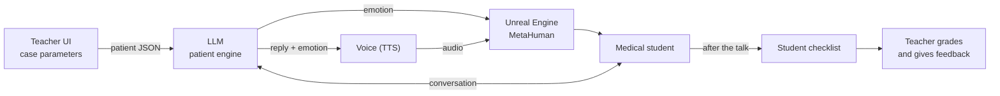

# VIP: Virtual Interview Patient

HackaTUM 2026, challenge by Avelios: **give every future doctor a patient to practise on.**

Simulated-patient actors are scarce and expensive. We are building a virtual patient that medical students can talk to at any time to practise history-taking. The patient has a medical background and a personality, and reveals facts only when asked.

## Pipeline



1. **Case creation.** The teacher enters the simulation parameters: diagnosis, age, gender, medical history, secrets the patient does not want to tell, and personality (aggressive, shy, ...). The UI exports them as JSON.
2. **Patient engine.** The LLM takes this JSON and holds a whole conversation in character. Each turn returns the reply and an emotion for voice and face. The student's speech is turned into text first.
3. **Voice.** The reply is spoken with the requested emotion.
4. **Visualisation.** An Unreal Engine MetaHuman plays the audio and shows the matching facial expression.
5. **Feedback.** After the conversation the student fills out a checklist (for example: what did you find out about the patient?). The teacher grades the student based on it.

## Interfaces (draft, agree on these first)

These two formats let all four of us work in parallel. The values are examples.

**Patient case** (Teacher UI → LLM), draft to refine in #7:

```json
{
  "diagnosis": "stable angina",
  "age": 58,
  "gender": "male",
  "medical_history": ["high blood pressure"],
  "medication": ["blood-pressure tablets, often forgotten"],
  "symptoms": ["chest tightness on the stairs since Tuesday"],
  "lifestyle": ["20 cigarettes a day for 30 years"],
  "secrets": ["often skips medication"],
  "personality": ["downplays everything", "dry humour"]
}
```

**Patient turn** (LLM → voice and visualisation), proposal to confirm in #5:

```json
{
  "reply": "Honestly, it's probably nothing. My wife made me come.",
  "emotion": "neutral",
  "intensity": 0.5
}
```

Voice and face share one `emotion` field. The values are MetaHuman's moods: `neutral`, `happy`, `sad`, `fear`, `disgust`, `anger`, `surprise`, `boredom`, `confidence`, `confusion`, `excitement`, `playfulness`. Unknown values fall back to `neutral`. The 0 to 1 scale for `intensity` is a suggestion.

## Who hands what to whom

| From | To | What | Issue |
|---|---|---|---|
| Maia | Senan, Nayer | Case schema and two example cases | #7 |
| Senan | Nayer, Jennifer | Turn endpoint, with fake turns early | #13 |
| Nayer | Senan | Final transcript of the student's speech | #18 |
| Nayer | Jennifer | Patient audio (format still open) | #17, #23 |
| Jennifer | Everyone | Confirmed list of usable emotions | #22 |

## Work plan

**Start together with #5** (agree on the interfaces). Then work through your column from top to bottom. Each issue has its steps, a "done when" and what it needs first.

| Maia: teacher UI (#1) | Senan: patient engine (#2) | Nayer: voice (#3) | Jennifer: Unreal (#4) |
|---|---|---|---|
| #6 Research parameters | #10 Text chat | #16 Try ElevenLabs | #21 Unreal and MetaHuman setup |
| #7 Schema and example cases | #11 Persona prompt (with Nayer) | #17 Text-to-speech | #22 Live face test and moods |
| #8 Teacher form | #12 Disclosure and consistency | #18 Speech-to-text | #23 Generated audio to face (with Nayer) |
| #9 Export and hand over | #13 Turn output and endpoint | #19 Pauses and interruptions | #24 Receive turns |
| | #14 Latency (with Nayer) | #20 Full voice loop (with Senan) | #25 Emotions and idle behaviour |
| | #15 Evaluation | | #26 Demo view |

**At the end, everyone:** #28 integration, then #29 demo and backup video.
**No owner yet:** #27 student checklist and grading.

**Priority if time runs short:** the voice loop (#20) with a good patient (#11, #12) comes first. It covers the must-haves without Unreal or the teacher UI.

## Getting started

```bash
git clone https://github.com/superc0mputer/avelios-hackaTUM-2026.git
```

So far only the Unreal patient can be run (see below). Other setup instructions get added as each part lands.

- **OpenAI key:** Avelios offers a key with capped usage. Message them on Discord with team name, all members and one contact person with contact details.
- **ElevenLabs key:** check the free limits on elevenlabs.io (#16).
- **Keys** go in a local `.env` file that is never committed.
- **Unreal:** version 5.8 (see below).
- **Questions:** the Avelios mentors are on site all weekend.

## Run the Unreal patient

The repository holds only our project file, config, C++ module and build scripts. The MetaHuman is **rebuilt on your machine** from an Epic preset, so no Epic assets are published.

**You need**
- macOS (tested on an M4 MacBook Air with 16 GB, Xcode 26.6) or Windows (**not tested yet**; needs Visual Studio 2022 with "Game development with C++"). Linux is not supported.
- Unreal Engine 5.8 with **MetaHuman Creator Core Data** (Epic Games Launcher → 5.8 → Options)
- An Epic account signed in through the launcher, and internet: textures and rig come from Epic's online services
- About 5 GB of free disk space (more for packaging), and a short repository path without spaces

macOS:

```bash
unreal/build.sh --run
```

Windows (PowerShell, from the repository folder; the policy flag applies to this run only):

```powershell
powershell -ExecutionPolicy Bypass -File unreal\build.ps1 -Run
```

The first build takes around 10 minutes per patient on the Mac we tested. Later runs skip what is already built. Options on macOS:

- `unreal/build.sh` builds without opening the window
- `unreal/build.sh --clean` rebuilds from scratch
- `UE_ROOT=/path/to/UE_5.8 unreal/build.sh` if Unreal is installed elsewhere

On Windows use `-Clean` and `-Run`, and set `$env:UE_ROOT` first if needed. Clone to a short path without spaces, such as `C:\dev`.

Logs are in `unreal/VIPPatient/Saved/BuildLogs/`. To edit the scene, open `unreal/VIPPatient/VIPPatient.uproject` after building.

### Standalone app

For people without Unreal, package the patient once per operating system, on that system:

```bash
unreal/package.sh
```

On Windows: `powershell -ExecutionPolicy Bypass -File unreal\package.ps1` (not tested yet). The app lands in `unreal/VIPPatient/Saved/Package/` and is about 2 GB. It contains Epic assets, so **never commit or publish it**; share it privately. The Mac app is not signed with a developer account yet, so another Mac will ask for permission the first time it opens.

### Patients

The app has six patients, built from Epic presets listed in `unreal/VIPPatient/Scripts/patients.json`. Ages are estimated from how the faces look:

| Patient | Gender | Looks about |
|---|---|---|
| Sunita | female | 28 |
| Lani | female | 58 |
| Grace | female | 76 |
| Trey | male | 25 |
| Bruce | male | 50 |
| Walter | male | 72 (default) |

The app shows the patient closest to the case: gender first, then age. For now this comes from the command line, for example `-VIPGender=female -VIPAge=25` (from the case JSON later, #24). The camera and face lights follow the patient's head height.

To add a patient, add a line to `patients.json` with an Epic preset name (see `Engine/Plugins/MetaHuman/MetaHumanCharacter/Content/Optional/Presets` in the Unreal folder) and run the build again. Each patient adds about 10 minutes of build time and about 0.5 GB to the app.

### How the patient speaks

`Source/VIPPatient` feeds speech audio straight into MetaHuman's audio-to-face solver, so generated voice (ElevenLabs) moves the lips without a microphone or virtual audio cable. The same samples are played as sound, held back about 0.12 s so lips and voice line up.

- `UVIPSpeechSubsystem::Speak(samples, rate)`: mono 16-bit PCM at any rate (24 kHz is used inside).
- `UVIPSpeechSubsystem::SetEmotion(emotion, intensity)`: one of the shared emotion names; unknown names fall back to `neutral`. Intensity goes from 0 to 2. A new emotion blends in over about a second. It stays at full strength while the patient speaks and for 4 s after, then eases to half strength until the next turn (#39).
- The solver's own moods are subtle and stop at intensity 1, so `VIPExpressions.cpp` adds face controls for each emotion (brows, eyes, cheeks, nose, mouth corners, based on FACS action units) on top. Lips and jaw are left to lip sync.
- In silence the solver settles into a pose with the mouth open and teeth showing, which looks like the patient is about to speak. Between turns its face is faded out to a closed, relaxed mouth (in 0.5 s), and it takes over again within a few frames when speech starts.
- The body plays Epic's MetaHuman standing idle loop through `UVIPBodyAnimInstance` (`AS_MH_Neutral_Stand_Idle_Loop`, from the engine's MetaHuman plugin, not stored here), so the shoulders relax and the body breathes and shifts slightly instead of holding the A-pose. `-VIPBodyAnim=none` turns it off, `-VIPBodyAnim=<path>` uses another animation.
- `VIPLife.cpp` adds involuntary movement so the face is never still (#44): small eye jumps between the student's eyes and face, now and then a short glance aside (often with a blink), blinks every 2 to 6 s and sometimes double, slow slight brow, lid and mouth-corner movement, and head sway. Older patients move less and slower. Later issues steer it (gaze and head offsets, blink rate).
- `UVIPSpeechSubsystem::SetPain(level)` (#35): pain 0 to 10 from the case or the turn. There is no pain mood in MetaHuman, so the face is built from the Prkachin-Solomon pain action units (lowered brows, tightened eyes, wrinkled nose and raised upper lip, partly closed eyes). The face grows with the level, and from pain 3 the patient winces now and then. `-VIPPain=7`; shot steps `pain=6` and `wince`.
- `UVIPSpeechSubsystem::SetBreathing(pattern)` (#36): `normal` (14/min), `fast_shallow` (28/min), `laboured` (24/min, deep, with the shoulders), `slow_deep` (9/min), or a rate such as `22`; or `SetBreathing(rate, depth, shoulders)`. `VIPBody.cpp` plays the idle loop and lifts the shoulders with each breath (quicker in, short pause, slower out); changes ease in over a few seconds. Only the shoulders move: bending the spine opens a gap between collar and neck. `-VIPBreathing=fast_shallow`; shot step `breathing=laboured`; `-VIPBreathHold=0|1` freezes the breath for comparing screenshots.
- `UVIPSpeechSubsystem::SetAttention(state)` (#37): `listening` (eye contact, a small nod now and then), `thinking` (eyes up and to one side, head following a little, for the wait while the answer is generated) or `idle`. While speech plays the patient glances away more, as people do while talking. `StopSpeaking()` cuts the speech off when the student interrupts. In `-VIPShots`, the steps `listening`, `thinking` and `stop` do the same.

Try it with any 16-bit WAV file (for example one made with `say -o test.wav --data-format=LEI16@24000 "Hello doctor"` on macOS):

```bash
"/Users/Shared/Epic Games/UE_5.8/Engine/Binaries/Mac/UnrealEditor.app/Contents/MacOS/UnrealEditor" \
  "$PWD/unreal/VIPPatient/VIPPatient.uproject" -game -windowed -VIPWav=$PWD/test.wav -VIPMood=sad
```

The packaged app takes the same options. On macOS it is sandboxed, so put the file under `~/Library/Containers/io.github.superc0mputer.VIPPatient/Data/`.

`-VIPIntensity=1.5` sets the strength. `-VIPMoods=neutral,sad,neutral,anger -VIPMoodSeconds=5` steps through moods to compare them with neutral.

`-VIPShots=neutral,sad,sad@2,anger` takes a screenshot of each step (emotion, optionally `@intensity`) into `Saved/VIPShots/` and quits, so looks can be compared without anyone watching. `-VIPDumpControls` logs the face control values the layer writes. `-VIPWide=250` pulls the camera back to see the whole patient.

The patient repeats the file every few seconds and logs jaw, blink, head and mood values to `Saved/Logs`. Turns from the patient engine are not connected yet (#24).

**Rules for this public repository**
- Never commit anything from `Content/MetaHumans/`, `Content/Patient/` or `Saved/` (already ignored).
- Changes made by hand to those generated assets are lost on `--clean`. Put them into the scripts in `unreal/VIPPatient/Scripts/`.

**Current state:** the patient sits in a simple consultation room, speaks a WAV file with lip sync, blinks and moves the head slightly, in the game window and in a packaged Mac app. Tested on one Mac only; lip sync with a macOS test voice judged good by ear (ElevenLabs not tried yet). Not connected to the patient engine yet.

## Technical notes (from the docs, not yet tested by us)

- [MetaHuman audio source](https://dev.epicgames.com/documentation/metahuman/using-a-metahuman-audio-source-in-unreal-engine): drives the face live from a capture device and has the mood setting. We use its solver with our own audio instead (see above, #23).
- [ElevenLabs models](https://elevenlabs.io/docs/overview/models): `eleven_v4_turbo` and `eleven_v3_conversational` support audio tags for emotion.

## What the challenge asks for

| Must have | Nice to have | Not needed |
|---|---|---|
| Believable medical background story | Structured patient-history extraction | Login or user management |
| Patient speaks and understands English | Feedback for the student | Polished UI |
| Distinct personality, with emotion in the voice | Tool for teachers to create patients | Coverage of every speciality |
| Flowing conversation, facts only when asked | Avatar or facial expressions | Business plan or pitch slides |
| Working demo (recorded or live) | | |

**Judging:** naturalness (fast, in character), medical consistency (nothing invented or contradicted), personality (two patients with the same disease feel different) and a demo that works.

**Keep in mind**

- The avatar is a nice-to-have, so voice conversation has to work without Unreal.
- Measure latency per turn from the first prototype.
- Students interrupt, pause and change topic mid-sentence.
- Patients use lay language ("my chest feels tight", not "angina").
- We need a way to show the patient behaves correctly beyond one lucky run.
- For the demo: headset mic, backup video and a text fallback.
- API keys are capped. This repository is public, so never commit keys.

## Team

| Who | Area |
|---|---|
| Maia ([maiafilip](https://github.com/maiafilip)) | Teacher UI and patient JSON |
| Senan ([Senan04](https://github.com/Senan04)) | LLM patient engine, prompt engineering, latency |
| Nayer ([Nayer-kotry](https://github.com/Nayer-kotry)) | LLM patient engine and ElevenLabs voice |
| Jennifer ([superc0mputer](https://github.com/superc0mputer)) | Unreal Engine visualisation |

## Open questions

- Voice: ElevenLabs or something built into Unreal Engine? The issues currently assume ElevenLabs (#16, #23).
- Does real-time MetaHuman animation work well on our hardware? (#21, #22)
- How does generated audio get into Unreal? (#23)
- Backend language, and HTTP or WebSocket? (#5)
- Which patient parameters do we really need? (#6)
- What belongs on the student checklist, how is it graded, and who builds it? (#27)
