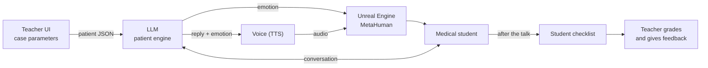

# VIP: Virtual Interview Patient

HackaTUM 2026, challenge by Avelios: **give every future doctor a patient to practise on.**

Simulated-patient actors are scarce and expensive. We are building a virtual patient that medical students can talk to at any time to practise history-taking. The patient has a medical background and a personality, and reveals facts only when asked.

## Pipeline



1. **Case creation.** The teacher enters the simulation parameters: diagnosis, age, gender, medical history, secrets the patient does not want to tell, and personality (aggressive, shy, ...). The UI exports them as JSON.
2. **Patient engine.** The LLM takes this JSON and holds a whole conversation in character. Each turn returns the reply and an emotion for voice and face. The student's speech is turned into text first.
3. **Voice.** The reply is spoken with the requested emotion.
4. **Visualisation.** An Unreal Engine MetaHuman plays the audio and shows the matching facial expression.
5. **Feedback.** After the conversation the student fills out a checklist (for example: what did you find out about the patient?). The teacher grades the student based on it.

## Interfaces (draft, agree on these first)

These two formats let all four of us work in parallel. The values are examples.

**Patient case** (Teacher UI → LLM), draft to refine in #7:

```json
{
  "diagnosis": "stable angina",
  "age": 58,
  "gender": "male",
  "medical_history": ["high blood pressure"],
  "medication": ["blood-pressure tablets, often forgotten"],
  "symptoms": ["chest tightness on the stairs since Tuesday"],
  "lifestyle": ["20 cigarettes a day for 30 years"],
  "secrets": ["often skips medication"],
  "personality": ["downplays everything", "dry humour"]
}
```

**Patient turn** (LLM → voice and visualisation), proposal to confirm in #5:

```json
{
  "reply": "Honestly, it's probably nothing. My wife made me come.",
  "emotion": "neutral",
  "intensity": 0.5
}
```

Voice and face share one `emotion` field. The proposed values are MetaHuman's moods: `neutral`, `happy`, `sad`, `fear`, `disgust`, `anger`, `surprise`. Unknown values fall back to `neutral`. The 0 to 1 scale for `intensity` is a suggestion.

## Who hands what to whom

| From | To | What | Issue |
|---|---|---|---|
| Maia | Senan, Nayer | Case schema and two example cases | #7 |
| Senan | Nayer, Jennifer | Turn endpoint, with fake turns early | #13 |
| Nayer | Senan | Final transcript of the student's speech | #18 |
| Nayer | Jennifer | Patient audio (format still open) | #17, #23 |
| Jennifer | Everyone | Confirmed list of usable emotions | #22 |

## Work plan

**Start together with #5** (agree on the interfaces). Then work through your column from top to bottom. Each issue has its steps, a "done when" and what it needs first.

| Maia: teacher UI (#1) | Senan: patient engine (#2) | Nayer: voice (#3) | Jennifer: Unreal (#4) |
|---|---|---|---|
| #6 Research parameters | #10 Text chat | #16 Try ElevenLabs | #21 Unreal and MetaHuman setup |
| #7 Schema and example cases | #11 Persona prompt (with Nayer) | #17 Text-to-speech | #22 Live face test and moods |
| #8 Teacher form | #12 Disclosure and consistency | #18 Speech-to-text | #23 Generated audio to face (with Nayer) |
| #9 Export and hand over | #13 Turn output and endpoint | #19 Pauses and interruptions | #24 Receive turns |
| | #14 Latency (with Nayer) | #20 Full voice loop (with Senan) | #25 Emotions and idle behaviour |
| | #15 Evaluation | | #26 Demo view |

**At the end, everyone:** #28 integration, then #29 demo and backup video.
**No owner yet:** #27 student checklist and grading.

**Priority if time runs short:** the voice loop (#20) with a good patient (#11, #12) comes first. It covers the must-haves without Unreal or the teacher UI.

## Getting started

```bash
git clone https://github.com/superc0mputer/avelios-hackaTUM-2026.git
```

There is no code yet, so setup instructions get added here as each part lands.

- **OpenAI key:** Avelios offers a key with capped usage. Message them on Discord with team name, all members and one contact person with contact details.
- **ElevenLabs key:** check the free limits on elevenlabs.io (#16).
- **Keys** go in a local `.env` file that is never committed.
- **Unreal:** version 5.6 or later with the MetaHuman plugins (#21).
- **Questions:** the Avelios mentors are on site all weekend.

## Technical notes (from the docs, not yet tested by us)

- [MetaHuman audio source](https://dev.epicgames.com/documentation/metahuman/using-a-metahuman-audio-source-in-unreal-engine): drives the face live from a capture device and has the mood setting. It does not describe using generated audio, which is our biggest risk (#23).
- [ElevenLabs models](https://elevenlabs.io/docs/overview/models): `eleven_v4_turbo` and `eleven_v3_conversational` support audio tags for emotion.

## What the challenge asks for

| Must have | Nice to have | Not needed |
|---|---|---|
| Believable medical background story | Structured patient-history extraction | Login or user management |
| Patient speaks and understands English | Feedback for the student | Polished UI |
| Distinct personality, with emotion in the voice | Tool for teachers to create patients | Coverage of every speciality |
| Flowing conversation, facts only when asked | Avatar or facial expressions | Business plan or pitch slides |
| Working demo (recorded or live) | | |

**Judging:** naturalness (fast, in character), medical consistency (nothing invented or contradicted), personality (two patients with the same disease feel different) and a demo that works.

**Keep in mind**

- The avatar is a nice-to-have, so voice conversation has to work without Unreal.
- Measure latency per turn from the first prototype.
- Students interrupt, pause and change topic mid-sentence.
- Patients use lay language ("my chest feels tight", not "angina").
- We need a way to show the patient behaves correctly beyond one lucky run.
- For the demo: headset mic, backup video and a text fallback.
- API keys are capped. This repository is public, so never commit keys.

## Team

| Who | Area |
|---|---|
| Maia ([maiafilip](https://github.com/maiafilip)) | Teacher UI and patient JSON |
| Senan ([Senan04](https://github.com/Senan04)) | LLM patient engine, prompt engineering, latency |
| Nayer ([Nayer-kotry](https://github.com/Nayer-kotry)) | LLM patient engine and ElevenLabs voice |
| Jennifer ([superc0mputer](https://github.com/superc0mputer)) | Unreal Engine visualisation |

## Open questions

- Voice: ElevenLabs or something built into Unreal Engine? The issues currently assume ElevenLabs (#16, #23).
- Does real-time MetaHuman animation work well on our hardware? (#21, #22)
- How does generated audio get into Unreal? (#23)
- Backend language, and HTTP or WebSocket? (#5)
- Which patient parameters do we really need? (#6)
- What belongs on the student checklist, how is it graded, and who builds it? (#27)
