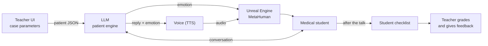

# VIP: Virtual Interview Patient

HackaTUM 2026, challenge by Avelios: **give every future doctor a patient to practise on.**

Simulated-patient actors are scarce and expensive. We are building a virtual patient that medical students can talk to at any time to practise history-taking. The patient has a medical background and a personality, and reveals facts only when asked.

## Pipeline



1. **Case creation.** The teacher enters a short patient profile, symptom/history text, secrets, and personality/mood. The UI assigns the numbered case ID, derives the pair ID from the diagnosis, and exports schema-valid JSON.
2. **Patient engine.** The LLM takes this JSON and holds a whole conversation in character. Each turn returns the reply and an emotion for voice and face. The student's speech is turned into text first.
3. **Voice.** The reply is spoken with the requested emotion.
4. **Visualisation.** An Unreal Engine MetaHuman plays the audio and shows the matching facial expression.
5. **Feedback.** After the conversation the student fills out a checklist (for example: what did you find out about the patient?). The teacher grades the student based on it.

## Interfaces

The patient case format is defined by [`cases/patient-case.schema.json`](cases/patient-case.schema.json). The teacher UI stores only case-specific information: patient details, diagnosis, personality and mood, free-text facts, and reluctant-to-reveal secrets. It assigns numbered case IDs, derives the pair ID from the diagnosis, and generates evaluation IDs automatically. Clinic setting and interview task are fixed app defaults; disclosure behavior follows the personality type.

**Patient turn** (LLM → voice and visualisation), proposal to confirm in #5:

```json
{
  "reply": "Honestly, it's probably nothing. My wife made me come.",
  "emotion": "neutral",
  "intensity": 0.5
}
```

Voice and face share one `emotion` field. The values are MetaHuman's moods: `neutral`, `happy`, `sad`, `fear`, `disgust`, `anger`, `surprise`, `boredom`, `confidence`, `confusion`, `excitement`, `playfulness`. Unknown values fall back to `neutral`. The 0 to 1 scale for `intensity` is a suggestion.

Each patient case has a `personality.mood` field. It defines the patient's initial mood and should be used as the starting turn emotion.

## Who hands what to whom

| From | To | What | Issue |
|---|---|---|---|
| Maia | Senan, Nayer | Case schema and two example cases | #7 |
| Senan | Nayer, Jennifer | Turn endpoint, with fake turns early | #13 |
| Nayer | Senan | Final transcript of the student's speech | #18 |
| Nayer | Jennifer | Patient audio (format still open) | #17, #23 |
| Jennifer | Everyone | Confirmed list of usable emotions | #22 |

## Work plan

**Start together with #5** (agree on the interfaces). Then work through your column from top to bottom. Each issue has its steps, a "done when" and what it needs first.

| Maia: teacher UI (#1) | Senan: patient engine (#2) | Nayer: voice (#3) | Jennifer: Unreal (#4) |
|---|---|---|---|
| #6 Research parameters | #10 Text chat | #16 Try ElevenLabs | #21 Unreal and MetaHuman setup |
| #7 Schema and example cases | #11 Persona prompt (with Nayer) | #17 Text-to-speech | #22 Live face test and moods |
| #8 Teacher form | #12 Disclosure and consistency | #18 Speech-to-text | #23 Generated audio to face (with Nayer) |
| #9 Export and hand over | #13 Turn output and endpoint | #19 Pauses and interruptions | #24 Receive turns |
| | #14 Latency (with Nayer) | #20 Full voice loop (with Senan) | #25 Emotions and idle behaviour |
| | #15 Evaluation | | #26 Demo view |

**At the end, everyone:** #28 integration, then #29 demo and backup video.
**No owner yet:** #27 student checklist and grading.

**Priority if time runs short:** the voice loop (#20) with a good patient (#11, #12) comes first. It covers the must-haves without Unreal or the teacher UI.

## Getting started

```bash
git clone https://github.com/superc0mputer/avelios-hackaTUM-2026.git
```

So far only the Unreal patient can be run (see below). Other setup instructions get added as each part lands.

- **OpenAI key:** Avelios offers a key with capped usage. Message them on Discord with team name, all members and one contact person with contact details.
- **ElevenLabs key:** check the free limits on elevenlabs.io (#16).
- **Keys** go in a local `.env` file that is never committed.
- **Unreal:** version 5.8 (see below).
- **Questions:** the Avelios mentors are on site all weekend.

## Run the voice patient (ElevenLabs + engine)

ElevenLabs Agents does speech-to-text, turn-taking and the voice. It calls our engine as its **custom LLM** on every turn: `engine/voice_server.py` builds the patient prompt from the case and streams the OpenAI reply back.

```bash
cd engine
python -m venv .venv && .venv/bin/pip install -r requirements.txt   # or: uv venv && uv pip install -r requirements.txt
cp .env.example .env    # add OPENAI_API_KEY; optional ENGINE_API_KEY, PATIENT_CASE_PATH
.venv/bin/uvicorn voice_server:app --host 127.0.0.1 --port 8787
cloudflared tunnel --url http://127.0.0.1:8787   # ElevenLabs needs a public HTTPS URL
```

To interview a case made in the teacher UI, run the teacher UI next to it (`cd teacher-ui && python server.py`, `TEACHER_UI_HOST=0.0.0.0` to reach it from another machine), save a case and click **Start conversation**. It loads the case into the voice server (`POST /case`, local only) and opens a **live interview panel on the same page** (ElevenLabs browser SDK, live transcript; set `ELEVENLABS_AGENT_ID` in `engine/.env`). The microphone only works over **HTTPS** or on `localhost`: serve the teacher UI over HTTPS (e.g. `tailscale serve --https=8446 8765`) and map `/ws` to the voice server on the same host (`tailscale serve --https=8446 --set-path /ws http://127.0.0.1:8787/ws`), so the page can relay the patient's voice to Unreal. Teacher-UI cases are translated to the engine's `PatientConfig` by `engine/case_adapter.py`: first symptom = told freely, other facts = only when asked, secrets = gated; the diagnosis never reaches the patient.

In the ElevenLabs agent: LLM = **Custom LLM**, server URL = `https://<tunnel-host>/v1`, API key = the same value as `ENGINE_API_KEY` (stored as a secret). Leave the agent's own prompt short and the first message empty; the patient waits for the student. Through the tunnel only `/v1/chat/completions`, `/v1/models` and `/health` are reachable. Tests: `.venv/bin/python -m pytest -q tests`.

### Connect the MetaHuman

The patient's voice and emotion reach Unreal through the voice server:

```
teacher page (ElevenLabs SDK) --audio--> voice server /ws/stage --audio + emotion--> /ws/unreal <-- Unreal (VIPBackendLink)
```

- Start the voice server on an address Unreal can reach (`--host 0.0.0.0`; `/ws/*` is refused through the public tunnel).
- Start Unreal with `VIP_SERVER=ws://<voice-server-ip>:8787/ws/unreal unreal/build.sh --run`, or pass `-VIPServer=ws://...` to the editor or the packaged app. Use an IPv4 address (e.g. `127.0.0.1` or the host's Tailscale IP), not `localhost` or a hostname: the voice server listens on IPv4 only, and macOS may try IPv6 first.
- Messages to Unreal, as JSON text:
  - `{"type":"audio","sample_rate":16000,"pcm_b64":...}`: the patient's voice as mono 16-bit PCM → `UVIPSpeechSubsystem::Speak`;
  - `{"type":"emotion","emotion":"sad","intensity":0.6}` → `SetEmotion` (the case's starting mood for now);
  - `{"type":"interrupt"}`: the student talked over the patient (logged only for now).
- While an Unreal client is connected, the teacher page mutes its own playback, so the patient speaks only through the MetaHuman.

## Run the voice patient without ElevenLabs (OpenAI voice)

A second route next to ElevenLabs that needs only the OpenAI key (no ElevenLabs credits, no public tunnel). In the teacher UI's live interview panel choose **Voice: OpenAI** (the default when no `ELEVENLABS_AGENT_ID` is set) and click **Start talking**.

```bash
cd engine && .venv/bin/uvicorn voice_server:app --host 127.0.0.1 --port 8787
cd teacher-ui && python server.py          # open http://127.0.0.1:8765
VIP_SERVER=ws://127.0.0.1:8787/ws/unreal unreal/build.sh --run   # optional: the MetaHuman speaks
```

- The page finds each utterance itself (microphone level, about 0.9 s of silence ends it) and sends it over `/ws/talk` (local only).
- `engine/openai_voice.py` transcribes it (`OPENAI_STT_MODEL`, default `gpt-4o-mini-transcribe`), lets the patient engine answer with the same system prompt as the ElevenLabs route, and speaks the answer sentence by sentence with `OPENAI_TTS_MODEL` (default `gpt-4o-mini-tts`). Its `instructions` describe the patient from the case: age, gender, mood, communication style, pain. Voice: `ash` for men, `coral` for women, or `OPENAI_TTS_VOICE`.
- The audio (mono 16-bit PCM, 24 kHz) goes to Unreal over `/ws/unreal` with `state` messages (listening, thinking, idle), or is played in the page when no MetaHuman is connected.
- Half duplex: while the patient thinks or speaks, the microphone is ignored, so the patient's voice from the speakers never counts as the student. The student cannot interrupt by talking; use a headset for the demo anyway.
- Costs go to the OpenAI key (speech-to-text, the patient model, text-to-speech per turn).
- Loading a teacher case (`POST /case`, both routes) now also sends the case to Unreal (`{"type":"case"}`), so the MetaHuman shows the case's patient, mood and presentation (#45).

## Run the Unreal patient

The repository holds only our project file, config, C++ module and build scripts. The MetaHuman is **rebuilt on your machine** from an Epic preset, so no Epic assets are published.

**You need**
- macOS (tested on an M4 MacBook Air with 16 GB, Xcode 26.6, and an M2 Pro MacBook Pro with 16 GB, Xcode 27) or Windows (**not tested yet**; needs Visual Studio 2022 with "Game development with C++"). Linux is not supported.
- Unreal Engine 5.8 with **MetaHuman Creator Core Data** (Epic Games Launcher → 5.8 → Options)
- An Epic account signed in through the launcher, and internet: textures and rig come from Epic's online services
- On Xcode 26 or later, the Metal toolchain (Unreal compiles its shaders with it; without it the first build stops with "missing Metal Toolchain"): `xcodebuild -downloadComponent MetalToolchain`
- About 5 GB of free disk space (more for packaging), and a short repository path without spaces

macOS:

```bash
unreal/build.sh --run
```

Windows (PowerShell, from the repository folder; the policy flag applies to this run only):

```powershell
powershell -ExecutionPolicy Bypass -File unreal\build.ps1 -Run
```

The first build takes around 10 minutes per patient on the Mac we tested (about 15 on a second Mac, with Unreal on a USB drive). During the first step Epic may ask you to sign in; the build waits for it. Building the MetaHuman briefly needs more than 16 GB of memory, so close other heavy apps. Later runs skip what is already built. Options on macOS:

- `unreal/build.sh` builds without opening the window
- `unreal/build.sh --clean` rebuilds from scratch
- `UE_ROOT=/path/to/UE_5.8 unreal/build.sh` if Unreal is installed elsewhere

On Windows use `-Clean` and `-Run`, and set `$env:UE_ROOT` first if needed. Clone to a short path without spaces, such as `C:\dev`.

Logs are in `unreal/VIPPatient/Saved/BuildLogs/`. To edit the scene, open `unreal/VIPPatient/VIPPatient.uproject` after building.

### Standalone app

For people without Unreal, package the patient once per operating system, on that system:

```bash
unreal/package.sh
```

On Windows: `powershell -ExecutionPolicy Bypass -File unreal\package.ps1` (not tested yet). The app lands in `unreal/VIPPatient/Saved/Package/` and is about 2 GB. It contains Epic assets, so **never commit or publish it**; share it privately. The Mac app is not signed with a developer account yet, so another Mac will ask for permission the first time it opens.

### Demo view (#26)

- Full screen: start the packaged app with `-fullscreen` (standard Unreal flag). Not verified yet: in a test with the Mac's screen locked, the app hung while creating the window (macOS cannot switch to a full-screen Space on a locked screen), while `-windowed` worked. Try it once with the screen unlocked; fallback: `-windowed -resx=<screen width> -resy=<screen height>`.
- Delay Unreal adds: speech is held back 0.12 s so lips and voice line up (`SoundDelaySeconds`). Measured in the game window on an M4 MacBook Air (10 sentences, `-VIPWav=` runs log `VIP latency:` lines): the jaw opens 74 to 96 ms after `Speak()`, the sound is queued about 120 ms after it, so the mouth leads the sound by 25 to 46 ms plus the audio device's own latency. Viewers tolerate sound slightly after the lips much better than before them. The voice reaches the speakers about 0.13 s later than without Unreal; network and text-to-speech time come on top.
- Keep the demo machine otherwise idle: with a background process using a full core and a hot machine, the jaw opened 200 to 580 ms after `Speak()`, so the lips trailed the voice by up to 0.45 s.
- If Unreal fails: the teacher page plays the patient's voice itself whenever no Unreal client is connected to the voice server (#49), so the conversation goes on voice-only.
- Checked tonight: the packaged app (2.4 GB) loads a case, swaps the patient, plays the body idle and shows signs, breathing, emotions and pain.

### Patients

The app has six patients, built from Epic presets listed in `unreal/VIPPatient/Scripts/patients.json`. Ages are estimated from how the faces look:

| Patient | Gender | Looks about |
|---|---|---|
| Sunita | female | 28 |
| Lani | female | 58 |
| Grace | female | 76 |
| Trey | male | 25 |
| Bruce | male | 50 |
| Walter | male | 72 (default) |

The app shows the patient closest to the case: gender first, then age. For now this comes from the command line, for example `-VIPGender=female -VIPAge=25` (from the case JSON later, #24). The camera and face lights follow the patient's head position.

To add a patient, add a line to `patients.json` with an Epic preset name (see `Engine/Plugins/MetaHuman/MetaHumanCharacter/Content/Optional/Presets` in the Unreal folder) and run the build again. Each patient adds about 10 minutes of build time and about 0.5 GB to the app.

### The case decides the look (#45)

When a case is loaded (from the voice server, or `-VIPCase=cases/case-001.json`), Unreal shows the patient that fits it:

- **Who:** the case's `character_id` (`man-01` Bruce, `man-02` Walter, `man-03` Trey, `woman-01` Lani, `woman-02` Grace, `woman-03` Sunita, set in `patients.json`) if that patient's age is within 15 years of `patient.age`; otherwise the closest age of the same gender. A 58-year-old never gets a 25-year-old face.
- **Starting mood:** `personality.mood`.
- **Personality in body language:** `personality.type`: anxious_talkative blinks and looks around more and moves more, shy_reserved never fully holds eye contact, assertive holds a steady gaze, distrustful glances away with a slightly narrowed look and does not nod.
- **Visible signs** (#34, `presentation.visible_signs`): `pale`, `jaundice` (yellow skin and sclera), `cyanosis` (dusky bluish-grey skin; the skin material has no separate lip colour), `flushed`, `sweaty` (glossier skin), `red_eyes`, `tired`. `VIPSigns.cpp` changes the MetaHuman's own skin and eye material parameters at runtime, so no rebuild is needed. `-VIPSigns=pale,sweaty`; shot step `signs=pale+sweaty`. `-VIPDumpControls` also lists every material parameter.
- **Optional `presentation`** (proposed addition to the case schema): `{"pain": 0-10, "breathing": "normal|fast_shallow|laboured|slow_deep|<rate>", "discomfort": 0-1, "visible_signs": [...]}`. Pain and discomfort from the case are the floor: turns can raise them, not drop below.

Demo cases for the look: `unreal/VIPPatient/Cases/demo-*.json` (chest pain, COPD, depression, liver disease), e.g. `-VIPCase=unreal/VIPPatient/Cases/demo-copd.json`.

Test without the backend: `python3 unreal/VIPPatient/Scripts/fake_voice_server.py --wav reply.wav --case cases/case-001.json --pain 5 --breathing fast_shallow`, then start the game with `-VIPServer=ws://127.0.0.1:8787/ws/unreal` (use the IP: `localhost` failed to connect on macOS). It sends the case, then three turns with thinking, emotion and streamed audio, and interrupts the second one.

### How the patient speaks

`Source/VIPPatient` feeds speech audio straight into MetaHuman's audio-to-face solver, so generated voice (ElevenLabs) moves the lips without a microphone or virtual audio cable. The same samples are played as sound, held back about 0.12 s so lips and voice line up.

- `UVIPSpeechSubsystem::Speak(samples, rate)`: mono 16-bit PCM at any rate (24 kHz is used inside).
- `UVIPSpeechSubsystem::SetEmotion(emotion, intensity)`: one of the shared emotion names; unknown names fall back to `neutral`. Intensity goes from 0 to 2. A new emotion blends in over about a second. It stays at full strength while the patient speaks and for 4 s after, then eases to half strength until the next turn (#39).
- The solver's own moods are subtle and stop at intensity 1, so `VIPExpressions.cpp` adds face controls for each emotion (brows, eyes, cheeks, nose, mouth corners, based on FACS action units) on top. Lips and jaw are left to lip sync.
- In silence the solver settles into a pose with the mouth open and teeth showing, which looks like the patient is about to speak. Between turns its face is faded out to a closed, relaxed mouth (in 0.5 s), and it takes over again within a few frames when speech starts.
- The body plays Epic's MetaHuman standing idle loop through `UVIPBodyAnimInstance` (`AS_MH_Neutral_Stand_Idle_Loop`, from the engine's MetaHuman plugin, not stored here), so the shoulders relax and the body breathes and shifts slightly instead of holding the A-pose. `-VIPBodyAnim=none` turns it off, `-VIPBodyAnim=<path>` uses another animation.
- `VIPLife.cpp` adds involuntary movement so the face is never still (#44): small eye jumps between the student's eyes and face, now and then a short glance aside (often with a blink), blinks every 2 to 6 s and sometimes double, slow slight brow, lid and mouth-corner movement, and head sway. Older patients move less and slower. Later issues steer it (gaze and head offsets, blink rate).
- `UVIPSpeechSubsystem::SetPain(level)` (#35): pain 0 to 10 from the case or the turn. There is no pain mood in MetaHuman, so the face is built from the Prkachin-Solomon pain action units (lowered brows, tightened eyes, wrinkled nose and raised upper lip, partly closed eyes). The face grows with the level, and from pain 3 the patient winces now and then. `-VIPPain=7`; shot steps `pain=6` and `wince`.
- `UVIPSpeechSubsystem::SetBreathing(pattern)` (#36): `normal` (14/min), `fast_shallow` (28/min), `laboured` (24/min, deep, with the shoulders), `slow_deep` (9/min), or a rate such as `22`; or `SetBreathing(rate, depth, shoulders)`. `VIPBody.cpp` plays the idle loop and lifts the shoulders with each breath (quicker in, short pause, slower out); changes ease in over a few seconds. Only the shoulders move: bending the spine opens a gap between collar and neck. `-VIPBreathing=fast_shallow`; shot step `breathing=laboured`; `-VIPBreathHold=0|1` freezes the breath for comparing screenshots.
- `UVIPSpeechSubsystem::SetDiscomfort(0-1)` (#38): on sensitive topics the patient looks down and to the side, blinks more, stops nodding, and the inner brows rise a little; it eases back over a few seconds when discomfort drops. `-VIPDiscomfort=0.8`; shot step `discomfort=1`.
- **Head motion is kept small on purpose.** The head turn comes from the face rig, but the shirt follows the body, whose neck the face does not copy here (the copy-pose step in Epic's Live Link face anim seems inactive). A few degrees of pitch, or turning toward one side, pull the neck through the collar. So head offsets are clamped (yaw -1.2 to 6, pitch and roll about 1 degree), looking away always goes to the safe side (`-VIPSide=-1` to compare), and the body keeps pelvis, spine, neck and head at the rest pose the face is modelled for (only arms and shoulders follow the idle). The eyes do most of the looking.
- `UVIPSpeechSubsystem::SetAttention(state)` (#37): `listening` (eye contact, a small nod now and then), `thinking` (eyes up and to one side, head following a little, for the wait while the answer is generated) or `idle`. While speech plays the patient glances away more, as people do while talking. `StopSpeaking()` cuts the speech off when the student interrupts. In `-VIPShots`, the steps `listening`, `thinking` and `stop` do the same.

Try it with any 16-bit WAV file (for example one made with `say -o test.wav --data-format=LEI16@24000 "Hello doctor"` on macOS):

```bash
"/Users/Shared/Epic Games/UE_5.8/Engine/Binaries/Mac/UnrealEditor.app/Contents/MacOS/UnrealEditor" \
  "$PWD/unreal/VIPPatient/VIPPatient.uproject" -game -windowed -VIPWav=$PWD/test.wav -VIPMood=sad
```

The packaged app takes the same options. On macOS it is sandboxed, so put the file under `~/Library/Containers/io.github.superc0mputer.VIPPatient/Data/`.

`-VIPIntensity=1.5` sets the strength. `-VIPMoods=neutral,sad,neutral,anger -VIPMoodSeconds=5` steps through moods to compare them with neutral.

`-VIPShots=neutral,sad,sad@2,anger` takes a screenshot of each step (emotion, optionally `@intensity`) into `Saved/VIPShots/` and quits, so looks can be compared without anyone watching. `-VIPDumpControls` logs the face control values the layer writes. `-VIPWide=250` pulls the camera back to see the whole patient.

The patient repeats the file every few seconds and logs jaw, blink, head and mood values to `Saved/Logs`. Turns from the patient engine are not connected yet (#24).

**Rules for this public repository**
- Never commit anything from `Content/MetaHumans/`, `Content/Patient/` or `Saved/` (already ignored).
- Changes made by hand to those generated assets are lost on `--clean`. Put them into the scripts in `unreal/VIPPatient/Scripts/`.

**Current state:** the patient sits in a simple consultation room, speaks a WAV file with lip sync, blinks and moves the head slightly, in the game window and in a packaged Mac app. Tested on one Mac only; lip sync with a macOS test voice judged good by ear (ElevenLabs not tried yet). Not connected to the patient engine yet.

## Technical notes (from the docs, not yet tested by us)

- [MetaHuman audio source](https://dev.epicgames.com/documentation/metahuman/using-a-metahuman-audio-source-in-unreal-engine): drives the face live from a capture device and has the mood setting. We use its solver with our own audio instead (see above, #23).
- [ElevenLabs models](https://elevenlabs.io/docs/overview/models): `eleven_v4_turbo` and `eleven_v3_conversational` support audio tags for emotion.

## What the challenge asks for

| Must have | Nice to have | Not needed |
|---|---|---|
| Believable medical background story | Structured patient-history extraction | Login or user management |
| Patient speaks and understands English | Feedback for the student | Polished UI |
| Distinct personality, with emotion in the voice | Tool for teachers to create patients | Coverage of every speciality |
| Flowing conversation, facts only when asked | Avatar or facial expressions | Business plan or pitch slides |
| Working demo (recorded or live) | | |

**Judging:** naturalness (fast, in character), medical consistency (nothing invented or contradicted), personality (two patients with the same disease feel different) and a demo that works.

**Keep in mind**

- The avatar is a nice-to-have, so voice conversation has to work without Unreal.
- Measure latency per turn from the first prototype.
- Students interrupt, pause and change topic mid-sentence.
- Patients use lay language ("my chest feels tight", not "angina").
- We need a way to show the patient behaves correctly beyond one lucky run.
- For the demo: headset mic, backup video and a text fallback.
- API keys are capped. This repository is public, so never commit keys.

## Team

| Who | Area |
|---|---|
| Maia ([maiafilip](https://github.com/maiafilip)) | Teacher UI and patient JSON |
| Senan ([Senan04](https://github.com/Senan04)) | LLM patient engine, prompt engineering, latency |
| Nayer ([Nayer-kotry](https://github.com/Nayer-kotry)) | LLM patient engine and ElevenLabs voice |
| Jennifer ([superc0mputer](https://github.com/superc0mputer)) | Unreal Engine visualisation |

## Open questions

- Voice: ElevenLabs or something built into Unreal Engine? The issues currently assume ElevenLabs (#16, #23).
- Does real-time MetaHuman animation work well on our hardware? (#21, #22)
- How does generated audio get into Unreal? (#23)
- Backend language, and HTTP or WebSocket? (#5)
- Which patient parameters do we really need? (#6)
- What belongs on the student checklist, how is it graded, and who builds it? (#27)
