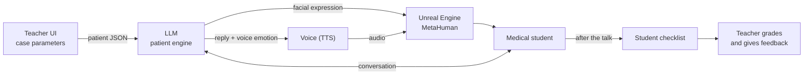

# VIP: Virtual Interview Patient

HackaTUM 2026, challenge by Avelios: **give every future doctor a patient to practise on.**

Simulated-patient actors are scarce and expensive. We are building a virtual patient that medical students can talk to at any time to practise history-taking. The patient has a medical background and a personality, and reveals facts only when asked.

## Pipeline



1. **Case creation.** The teacher enters the simulation parameters: diagnosis, age, gender, medical history, secrets the patient does not want to tell, and personality (aggressive, shy, ...). The UI exports them as JSON.
2. **Patient engine.** The LLM takes this JSON and holds a whole conversation in character. Each turn returns the reply, an emotion for the voice and a facial expression.
3. **Voice.** The reply is spoken with the requested emotion.
4. **Visualisation.** An Unreal Engine MetaHuman plays the audio and shows the facial expression.
5. **Feedback.** After the conversation the student fills out a checklist (for example: what did you find out about the patient?). The teacher grades the student based on it.

## Interfaces (draft, agree on these first)

These two formats let all four of us work in parallel. The values are examples.

**Patient case** (Teacher UI → LLM):

```json
{
  "diagnosis": "stable angina",
  "age": 58,
  "gender": "male",
  "medical_history": ["high blood pressure"],
  "medication": ["blood-pressure tablets, often forgotten"],
  "symptoms": ["chest tightness on the stairs since Tuesday"],
  "lifestyle": ["20 cigarettes a day for 30 years"],
  "secrets": ["often skips medication"],
  "personality": ["downplays everything", "dry humour"]
}
```

**Patient turn** (LLM → voice and visualisation):

```json
{
  "reply": "Honestly, it's probably nothing. My wife made me come.",
  "voice_emotion": "dismissive",
  "facial_expression": "slight_smile"
}
```

The LLM may only choose a `facial_expression` from the list the visualisation supports. That list is still to be defined.

## What the challenge asks for

| Must have | Nice to have | Not needed |
|---|---|---|
| Believable medical background story | Structured patient-history extraction | Login or user management |
| Patient speaks and understands English | Feedback for the student | Polished UI |
| Distinct personality, with emotion in the voice | Tool for teachers to create patients | Coverage of every speciality |
| Flowing conversation, facts only when asked | Avatar or facial expressions | Business plan or pitch slides |
| Working demo (recorded or live) | | |

**Judging:** naturalness (fast, in character), medical consistency (nothing invented or contradicted), personality (two patients with the same disease feel different) and a demo that works.

**Keep in mind**

- The avatar is a nice-to-have, so voice conversation has to work without Unreal.
- Measure latency per turn from the first prototype.
- Students interrupt, pause and change topic mid-sentence.
- Patients use lay language ("my chest feels tight", not "angina").
- We need a way to show the patient behaves correctly beyond one lucky run.
- For the demo: headset mic, backup video and a text fallback.
- API keys are capped. This repository is public, so never commit keys.

## Team

| Who | Area |
|---|---|
| Maia ([maiafilip](https://github.com/maiafilip)) | Teacher UI and patient JSON |
| Senan ([Senan04](https://github.com/Senan04)) | LLM patient engine, prompt engineering, latency |
| Nayer ([Nayer-kotry](https://github.com/Nayer-kotry)) | LLM patient engine and ElevenLabs voice |
| Jennifer ([superc0mputer](https://github.com/superc0mputer)) | Unreal Engine visualisation |

## Open questions

- Voice: ElevenLabs or something built into Unreal Engine?
- MetaHumans: which facial expressions are available out of the box and for free?
- Which patient parameters do we really need? (needs research)
- What belongs on the student checklist, and how is it graded? (needs research, **no owner yet**)
